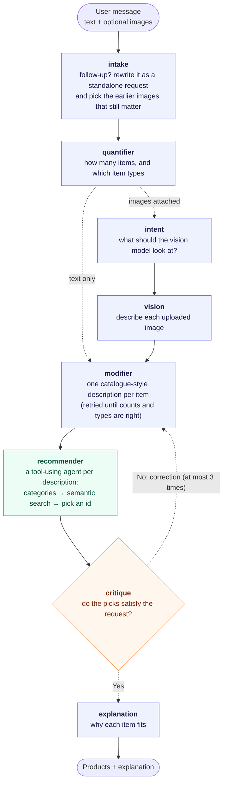
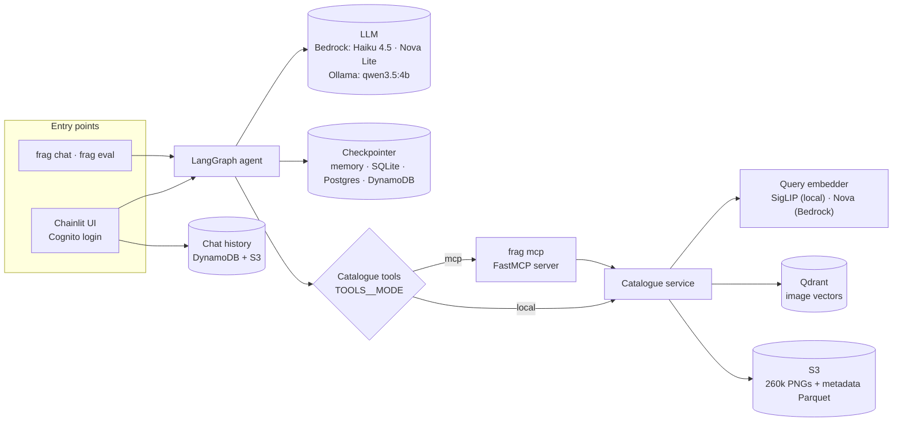

<div align="center">

# 👗 FRAG: Fashion Recommendation Agent

**Show it a photo, tell it what you need, and get real products from a 260,000-item catalogue that fit.**

A multimodal, self-correcting agentic RAG system built on LangGraph: it reads your text
and images, plans what to search for, retrieves matching products, critiques its own
picks and explains them.

[](https://github.com/TheDansmod/fashion_mas/actions/workflows/04-ci.yml)


</div>

https://github.com/user-attachments/assets/cc40f339-4bd2-4075-aea9-9388405977f5

---

## Highlights

| | |
|---|---|
| **Stateful LangGraph agent** | Eight specialised nodes with conditional routing. Each user message is one graph run, and the conversation state is checkpointed per thread, so follow-ups like *"the second one, but in black"* work. |
| **Self-correcting retrieval** | Inspired by Self-RAG: a critique node checks the picks against the request and sends a structured correction back to the planner (up to 3 times). Product IDs the LLM picks are checked against the IDs the search actually returned. |
| **Multimodal end to end** | Uploaded images are described by the vision node, and catalogue images go back to the LLM inside tool results, so it compares what the products *look* like, not just their text. |
| **Two embedding backends** | `siglip` (local, default): Marqo-FashionSigLIP over 260k items. `nova` (AWS): Amazon Nova Multimodal Embeddings over a 10k-item collection. One setting switches them, and a startup check rejects a mismatched collection. |
| **Swappable LLMs** | Claude Haiku 4.5 or Amazon Nova Lite on **AWS Bedrock**, or a local vision model on **Ollama** (`qwen3.5:4b`) for free development. |
| **MCP tool server** | The catalogue tools (semantic search, categories, lookup) run in-process or behind a FastMCP server over streamable HTTP, with identical output either way. |
| **Four checkpointers** | Memory, SQLite, Postgres or DynamoDB, selected by `CHECKPOINTER__BACKEND`. |
| **Chainlit UI** | Streams each node as a step. Cognito sign-in (admin-created users only), persistent chat history in DynamoDB + S3, and per-message token accounting. |
| **LLM-as-a-judge evaluation** | 60 curated queries in four groups, scored on visual grounding, item suitability and completeness. Every run is a self-contained, reproducible directory that records completion rate and score. |
| **Infrastructure as code** | Every AWS resource is owned by a CloudFormation stack and changed only through reviewed change sets. CI runs ruff, the offline test suite and cfn-lint on every PR. |

---

## How the agent thinks

One graph run per user message. Dashed edges are conditional.



## System architecture



Each process (the UI, the MCP server, `frag eval`) opens its own resources once at
startup through `frag.runtime.open_resources` and closes them on exit. Nothing is shared
in memory between processes, and importing any module has no side effects.

---

## Quickstart

### 1. Install

```bash
uv sync --group siglip --group local-llm      # + --group dev for tests/lint, --group ingest for the HDF5 script
uv sync --all-groups --reinstall-package chainlit --link-mode copy   # Chainlit needs real files, not links
```

- The `siglip` group (CPU-only torch) is needed only for the local SigLIP embedder, and
  `local-llm` only for Ollama.
- Re-run the Chainlit command whenever Chainlit is reinstalled. If your shell sets
  `UV_LINK_MODE=symlink`, then `uv cache clean` or `uv cache prune` silently breaks the
  venv; repair it with `uv sync --reinstall --all-groups`, then the Chainlit command.
- You also need the AWS CLI v2 (system-wide), credentials through a named profile or
  `aws configure sso`, and podman or docker with compose. The catalogue is read from S3
  in every mode.

### 2. Configure

```bash
cp .env.example .env                              # pick a preset (below)
infra/scripts/write_env_from_stack.sh --write     # AWS resource names + the Cognito secret (never printed)
uv run chainlit create-secret                     # put it in .env as CHAINLIT_AUTH_SECRET
infra/scripts/create_user.sh <email>              # sign-up is admin-only
```

| Preset | LLM | Embeddings | Checkpointer | Cost |
|---|---|---|---|---|
| **Local development** (default) | Ollama `qwen3.5:4b` | SigLIP → `fashion_gen` (260k) | SQLite | free, apart from tiny S3 reads |
| **AWS** | Bedrock Claude Haiku 4.5 | Nova → `nova_fashion_gen` (10k) | DynamoDB | ~$0.035 per message |
| **AWS, budget** | Bedrock Nova Lite (`LLM__MODEL_ID=us.amazon.nova-lite-v1:0`) | either | either | ~15× cheaper than Haiku, and faster |

Every setting has a default in `src/frag/settings.py`; nested settings use a double
underscore (`CHECKPOINTER__BACKEND=dynamodb`). The Bedrock rate limit defaults per model
to ~90% of the account quota (10 requests/minute for Haiku, 200 for Nova Lite).

### 3. Start the services

```bash
podman compose up -d                                  # Qdrant, serving data/qdrant_storage/
podman compose --profile postgres up -d               # optional: Postgres checkpointer
```

For the local LLM, run `ollama pull qwen3.5:4b`, then start Ollama with its prompt cache
in system RAM turned off. By default the cache can grow to 8 GiB, and image-heavy agent
calls once filled 14 GB of RAM and froze the machine:

```bash
LLAMA_ARG_CACHE_RAM=0 OLLAMA_NUM_PARALLEL=1 OLLAMA_MAX_LOADED_MODELS=1 OLLAMA_CONTEXT_LENGTH=16384 \
  systemd-run --user --scope -p MemoryMax=6G -p MemorySwapMax=0 ollama serve
```

On an 8 GB GPU, `qwen3.5:4b` runs fully on the GPU in about 3.7 GB of VRAM at a 16k
context. Keep `LLM__REASONING=false` (the default): with thinking on, small models
return empty or invalid structured output.

### 4. Run

| What | Command |
|---|---|
| Chat UI | `uv run chainlit run app.py`, then open http://localhost:8000 |
| Terminal chat | `uv run frag chat` |
| MCP server | `uv run frag mcp` (port 9000, `/health`), plus `TOOLS__MODE=mcp` for the agent |
| Evaluation | `uv run frag eval [--limit N] [--skip-judge] [--skip-run --run-dir DIR]` |

---

## Evaluation

`frag eval` runs the agent over 60 curated queries in four groups (*goes well with X*,
*same item, different style*, *looks good on me*, *aesthetic from an image*), then has
an LLM judge score each answer for **visual grounding**, **item suitability** and
**completeness**. Each run writes a self-contained directory
`data/evaluation_runs/<UTC time>/`:

```
config.json       models, embedding backend, collection size, git commit
results.jsonl     one line per query, with status ok | no_recommendations | error
judgement.jsonl   one line per judged query
summary.json      completed/total and mean ± std, overall and per group
images/           copies of every input and recommended image
```

Failed queries are counted, not dropped, so the score always comes with a completion
rate. The judge defaults to the agent's LLM; set `EVALUATION__JUDGE_LLM__PROVIDER=bedrock`
to judge with Claude while the agent runs locally (~$0.30 for 60 queries; ~$3–5 with the
agent on Bedrock too).

> **Score:** a full 60-query re-run is pending. An earlier figure (9.37 ± 0.78) averaged
> only the 31 of 60 queries that completed, so it isn't reported.

> **Tip:** turn LangSmith tracing off for evaluation runs (`LANGSMITH_TRACING=false`).
> The traces include every base64 image, and uploading them can stall a run for minutes.

---

## Quality

```bash
uv run pytest                 # offline: fakes for the LLM, catalogue and AWS
uv run pytest -m ollama       # slow model-quality tests on the real agent (local Ollama, Qdrant, S3)
uv run ruff check             # every rule enabled; each exception is justified in ruff.toml
uv run cfn-lint infra/cloudformation/*.yaml
```

Opt-in markers `aws` and `bedrock` cover tests that touch real (and, for Bedrock, billed)
services. CI (`.github/workflows/04-ci.yml`) runs ruff, the offline suite and cfn-lint on
every pull request into `main`, with no cloud credentials. For coverage:
`uv run pytest --cov=frag --cov-report=term-missing:skip-covered`.

---

## AWS resources

Two CloudFormation stacks own everything: `frag-<env>-storage` (catalogue and
chat-elements buckets, checkpointer and chat-history tables) and `frag-<env>-auth`
(Cognito pool, domain, client and branding). All stateful resources are `Retain`. They
change only through `infra/scripts/`, which shows a change set and waits for a typed
confirmation:

```bash
infra/scripts/deploy.sh [layer] [Param=Value ...] [--dry-run]   # set up or update
infra/scripts/teardown.sh <layer>                               # refuses stacks that hold data
```

The standing cost is about **$0.18/month** (catalogue storage). See
[`docs/cloudformation.md`](docs/cloudformation.md) for the resource list, the
first-time setup order and the workflow.

---

## Project layout

```
app.py                     Chainlit entry point (UI, auth, chat history, streaming)
src/frag/
├── settings.py            one Pydantic settings tree, pure and cached
├── runtime.py             open_resources(): LLM, checkpointer, catalogue, tools per process
├── llm.py · checkpointer.py · logging_setup.py · tokens.py · messages.py · prompts.py
├── cli.py                 frag chat | eval | mcp
├── agent/                 graph.py (nodes + routing), state.py, schemas.py
├── catalogue/             S3 store, embedders, Qdrant search, the Catalogue service
├── tools/                 the ToolsClient protocol; in-process and MCP clients
├── mcp_server/            FastMCP server over the catalogue
├── evaluation/            the LLM-as-a-judge pipeline
└── ui/                    Chainlit step summaries and two Chainlit bug patches
scripts/                   data pipeline: HDF5 ingestion, vector DB build (record), Qdrant admin
infra/                     CloudFormation templates and the deploy/teardown scripts
tests/                     unit, integration and opt-in model-quality tests
```

**Data pipeline scripts** (run by path, e.g. `uv run python scripts/qdrant_admin.py info`):
`ingest_fashiongen.py` turns the Fashion-Gen HDF5 file into PNGs and Parquet on S3;
`build_vector_db.py` records how the Nova collection was embedded (billed, and it asks
first); `qdrant_admin.py` provides `info`, `sample`, `snapshot`, `restore` and
`copy-subset`.
